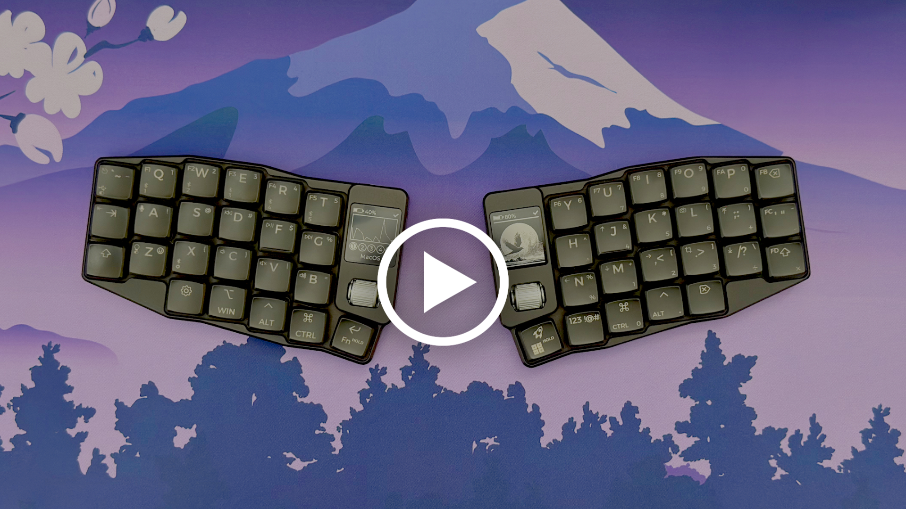
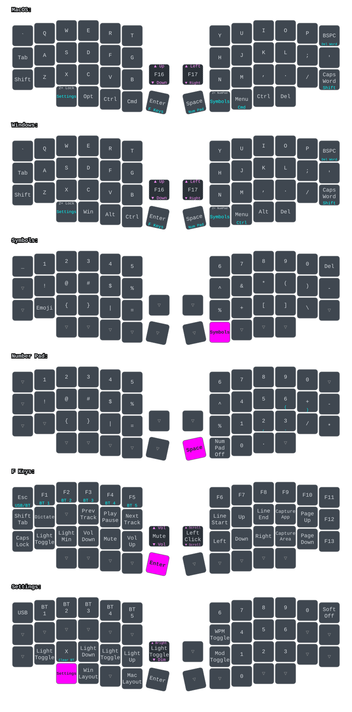

# RolioFirmware

This repository contains the firmware for the Rolio46 split wireless keyboard.

You can view a demo of its features in the video below:

[](https://www.youtube.com/watch?v=ROdyQWcNV8Y)

If you'd like to build your own Rolio46 you can find resources at the following two links:

- [Rolio46 Github](https://github.com/MickiusMousius/Rolio46Keyboard) - All the reousurces to build your own PCBs etc
- [Keydio.io](https://keydio.io) - Online store to buy a complete kit or just some parts to build your own Rolio46

<br/>

# How To Install/Flash Firmware To Your Rolio

This repository will produce firmware for the following controller & display combinations with the Rolio46:

- Supported Displays
  - Vista508
  - Vista272 / nice!view
- Supported Controllers
  - nice!nano / ProMicro NRF52840
  - Mikoto 7.20

You should hopefully be able to infer what files inside the release zip each mean.

The firmware.zip can be found in the "[Releases](https://github.com/MickiusMousius/RolioFirmware/releases/)" area.

To flash your Rolio46 use the following steps:

1.  Plug your right hand side Rolio into your computer.
2.  Quickly double press the reset button.
3.  You should now see a removable drive appear in your file explorer. If not try double pressing reset again and also verify your USB connection.
4.  Drag and drop the appropriate UF2 file to your Rolio's firmware volume & wait for it to finish copying.
5.  Repeat the process for the left hand side.
6.  Once the left side is successfully flashed the right side should inidicate that it has paired to the left.

Notes:

- If you encounter pairing issues you may need to load a "reset firmware" onto your board. You can follow the above process but substitute the "settings reset" UF2 for the controller you are using.
- Flashing the right hand side & then the left side seems to produce more consistent results (or has done so in the past, ZMK updates show constant improvements).
- More information about flashing SMK can be found here: [ZMK Flashing Issues](https://zmk.dev/docs/troubleshooting/flashing-issues)
- You can find some local development instructions here:
  - [Official Guide](https://zmk.dev/docs/development/local-toolchain/setup/container)
  - [My Local ZMK 0.3 Development Environment](doc/tools_setup.md)
  - [Compiling the RolioFirmware Locally](doc/building.md)

<br/>

# What Are Layers

Layers allow a keyboard to have more functions than physical keys. Even if you use a conventional keyboard you will be using layers on a day to day basis.

The "Shift Key" is a great example. When you want to type the "@" symbol you hold "Shift + 2", if you want to type the "<" symbol you hold "Shift + comma". In this regard you can think of the "Shift" key as activating an extra symbols and capitals layer on a conventional keyboard.

Those that use more compact keyboards or laptops may also be familiar with the "fn" key, this can be though of as activating a function keys layer.

The Rolio46 has a few more layers than a regular keyboard. This is done to keep the size down but also (and more importantly) to improve productivity & ergonomics over that of a regular keyboard layout.

<br/>

# About The Key Map

The Rolio46 comes with a built in set of layouts (and layers) for Windows & MacOS. You can use [ZMK Studio](https://zmk.studio/download) to customise these layouts any time, or if you're adventurous you can clone this repository & edit the keymap file to make far more advanced customisations.

To interpret the diagrams below use the following rules:

- If text is in **${\color{#00FFFF}Aqua\ Blue}$** then you need to hold the key down to make the key do whatever the **${\color{#00FFFF}Aqua\ Blue}$** text says.
- To activate a given layer (Symbols, NumberPad etc) hold down the button highlighted in **${\color{#FF00FF}Pink}$**.
- The keys marked with a small faded triangle will not change their behaviour when you change layer.

Special behaviours:

- **BSPC Key**
  - When this key is tapped it will behave like a normal backspace key
  - When held it will backspace whole words instead
    - For Windows this is CTRL + BSPC
    - For MacOS this is ALT + BSPC
- **Symbols Key**
  - If you quickly double tap the "Symbols" key it will stay in the number pad layer.
  - To exit the number pad layer tap the "Symbols" key once.
- **CapsWord Key**
  - If you taps the CapsWord key the next word you type will be in all capitals, once you enter a punctuation symbol your keyboard will exit CapsWord.
  - When in CapsWord mode you can also tap the CapsWord key once to disable it.
  - If you hold down the CapsWord key it will behave like a normal shift key.
- **Settings Key**
  - Hold the "Settings" key to temporarily use the settings layer.
  - If you quickly double tap the "Settings" key it will stay in the settings layer, tap it once to exit.
- **Caps Lock**
  - Caps Lock can be found on the function keys layer, when it's on the Vista508 will show it in the modifiers view.
- **Settings Layer**
  - Select Output
    - The keys along the top left select USB output, or Bluetooth output to profiles 1 through 5.
  - Bluetooth Passkey Entry
    - If your computer asks you to type in a passkey when pairing, type it using the number keys on the settings layer & press "Enter".
    - The Vista508 will show the passkey as you type it, then whether pairing succeeded.
  - Display Toggles
    - "WPM Toggle" cycles the Vista508 between the typing animation, a words per minute graph & the modifiers view.
    - "Mod Toggle" turns on/off automatically showing the modifiers view while modifier keys are held.
  - Clear Current Bluetooth Profile
    - You will need to hold this button down for 2 seconds to have an effect
    - This will delete the bonding information for the current bluetooth profile & reenter pairing mode
    - You can see it's worked when the profile indicator on your display changes to a "gear icon"
  - Set Profile To Windows Layout
    - Tapping this will cause the currently selected profile (bluetooth number or USB) to use the Windows layout for the main layer & also to use Windows bindings for the various shortcut & utility keys.
    - When switching connections your Rolio will remember the layout you've chosen.
  - Set Profile To MacOS Layout
    - Tapping this will cause the currently selected profile (bluetooth number or USB) to use the MacOS layout for the main layer & also to use MacOS bindings for the various shortcut & utility keys.
    - When switching connections your Rolio will remember the layout you've chosen.

<br/>

# The Vista508 Display

When using the Vista508 display the left side shows:

- **Battery & Connection** - The left side's battery level (with a charging animation when plugged in), along with a tick or cross showing whether the right side is connected. A warning is shown if the right side's battery is critically low.
- **Multi-View** - A typing animation that speeds up with your words per minute, a words per minute graph, or held modifiers (Shift, Ctrl, Alt, GUI, CapsWord & Caps Lock). It also shows Bluetooth passkey entry & pairing results, along with a large profile number or USB icon whenever you change output.
- **Output** - Whether output is going to USB or Bluetooth, along with the status of each Bluetooth profile.
- **Layer** - The name of the current layer.

The right side shows its own battery level, whether it's connected to the left side & some art.

<br/>

# Keymap Diagrams



_NOTE: These layout diagrams were created using a combination of [Keymap Drawer](https://github.com/caksoylar/keymap-drawer-web) and [Inkscape](https://inkscape.org)._

<br/>

# Development

To build the firmware locally see the [Building Guide](doc/building.md), once your [development environment](doc/tools_setup.md) is set up you can build both sides with:

```bash
/workspaces/zmk-modules/RolioFirmware/tools/build_rolio.sh
```

_To build only a specific side pass `left` or `right` to the script, see the [Building Guide](doc/building.md) for the other options._

Locally built firmware can be found in the `build/zmk/` folder, named after the controller, display & side it was built for (e.g. `rolio_nice_nano_v2-vista508_left.uf2`). It's flashed the same way as the firmware from a release.

This firmware makes use of the following ZMK modules:

- **`zmk-ls0xxvcom-driver`** - Sharp memory LCD driver for the Vista508, with regular VCOM inversion to prevent DC bias damage & image retention.
- **`zmk-defaultlayer`** - Remembers the default layer (MacOS or Windows) across reboots, for each Bluetooth profile & USB.
- **`zmk-ble-passkey`** - Reports Bluetooth passkey entry & pairing results so they can be shown on the display.
- **`zmk-smart-sleep`** - Keeps the right side awake while it's connected to the left side, but lets it sleep shortly after it disconnects.
- **`zmk-patch-batterylevel`** - A 21 point LiPo discharge curve & median of three sampling for an accurate battery level without jitter.
- **`zmk-patch-ec11`** - A patched rotary encoder driver that changes the interrupt logic so rotational pulses aren't dropped.

Repository structure:

- `boards/shields/rolio/` - The Rolio46 shield, keymap & custom behaviours.
- `boards/shields/vista508/` - The Vista508 display shield & its status screens (`src/` for the left side, `widgets/` for the right side).
- `config/` - ZMK configuration files (including `west.yml`).
- `doc/` - Documentation & setup guides.
- `dts/` - Devicetree bindings for the custom behaviours.
- `image_converter/` - Tool to generate the right side's display art.
- `tools/` - Build scripts & utility tools.
